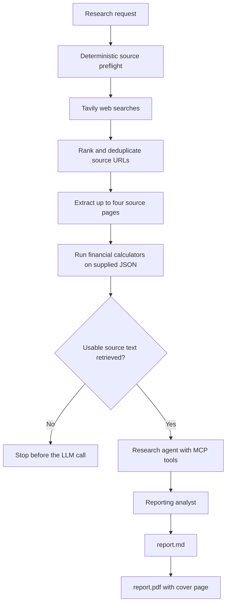

# India Equity Research Agent

An evidence-first research assistant for Indian listed companies, industries, and sectors. The project combines CrewAI agents, a local Model Context Protocol (MCP) server, web search and page extraction, deterministic financial calculators, and Markdown/PDF reporting.

The workflow is designed to collect source evidence and run available calculations **before the first paid language-model call**. It aims to reduce avoidable token use and improve traceability; it does not guarantee a particular research result, investment return, or total API cost.

## What it does

The agent supports four research modes:

| Mode | Assignment | Typical questions |
| --- | --- | --- |
| **L1 — Macro and Sector Research** | Analyze an Indian macro, sector, or sub-sector context. For a named company or industry, identify the relevant GICS-aligned sector before starting sector analysis. | What drives sector demand, capacity, pricing, regulation, and returns? Which macro indicators matter? |
| **L2 — Industry Universe Research** | Define an industry universe, identify listed candidates, and compare companies where evidence is comparable. Uses the GICS hierarchy of sectors, industry groups, and industries as a reference. | Which companies belong in the universe? What are their business and financial differences? |
| **L3 — Company Deep Dive** | Research one company’s business model, financial performance, governance, risks, capital allocation, and valuation inputs. | What supports or weakens the business and investment case? What information remains unresolved? |
| **L4 — Quarterly Monitoring** | Compare a new quarter with a supplied baseline and track changes in performance, guidance, risks, and thesis. | What changed this quarter, and what should be monitored next? |

Each assignment accepts a company, sector, or industry; identifiers such as ticker, exchange, or ISIN; a research question; a time horizon; optional filters; a prior-quarter baseline; and an optional local JSON file containing sourced financial inputs.

## Source-first workflow



The initial preflight calls the same Python search, extraction, and financial-analysis functions directly. It does this before the CrewAI crew is constructed or the LLM is called. If search returns no URLs, or no page text can be extracted, the run stops before the paid LLM call. The preflight also runs the deterministic financial-analysis function; without supplied financial data it returns an explicit `inputs_required` status rather than inventing figures.

After the preflight succeeds, the researcher agent can use the local MCP server for follow-up web searches, source-page extraction, and calculations while synthesizing the report. The reporting analyst then writes the final Markdown output.

## Sources and evidence standards

The prompt prioritizes primary evidence appropriate to the research question, including:

- Company websites, investor-relations pages, annual reports, results, presentations, and management statements.
- NSE and BSE filings and announcements.
- RBI, SEBI, MOSPI, ministries, regulators, and other government sources.
- Secondary publications for context or cross-checks, clearly labelled as secondary.

The report instructions distinguish verified, partially verified, not found after search, not retrieved, and search unavailable. They ask the agent to provide direct source links near material claims and identify publication dates, reporting periods, units, and accounting basis where available. A search snippet is treated as a lead, not proof that the underlying document was reviewed.

Retrieved web content is treated as untrusted data: instructions embedded in pages must not override the research prompt. The agent is instructed to separate reported facts, company guidance, third-party estimates, calculations, and analyst interpretation, and to describe conflicting, stale, or missing evidence.

### Sector and industry classification

L1 and L2 prompts include a GICS reference. For a named company or industry, the researcher should identify the relevant sector or industry rather than returning a generic survey of all sectors. L2 carries the classification down to industry group and industry where evidence allows. The prompt distinguishes a sourced official GICS assignment from an analyst’s GICS-aligned mapping, and asks the agent to explain uncertainty for diversified groups and differences from Indian local classifications.

## Analytical methodology and reporting standards

The earlier project README described a broader analyst framework that remains useful alongside this implementation’s source-first workflow. Reports should cover the following lenses when relevant evidence is available; missing or non-comparable inputs should be disclosed rather than estimated to fill a table.

### Company quality scorecard

Company assessments may summarize six dimensions on a clearly defined 10-point scale:

| Dimension | Example evidence to assess |
| --- | --- |
| Growth | Revenue, EBITDA, PAT and EPS trends; volume, price and mix drivers |
| Profitability | Gross and operating margins, PAT margin, and consistency of returns |
| Capital efficiency | ROE, ROCE or ROIC, with definitions and period basis stated |
| Balance sheet | Debt, liquidity, interest coverage, maturity profile and contingent obligations |
| Governance | Promoter ownership and pledges, related-party activity, auditor matters, disclosures and capital allocation |
| Valuation | Relevant multiples and cash-flow measures compared with history and suitable peers |

Scores are analytical summaries, not facts. Explain the basis for each score, disclose any weighting methodology if one is used, and avoid presenting a composite score when the underlying evidence is insufficient. Do not imply that a score is an implemented software feature unless the corresponding calculation or report output is present.

### Financial and forensic review

Where the data supports it, analyze revenue growth, EBITDA and PAT margins, EPS, ROE/ROCE/ROIC, free cash flow, debt-to-equity and interest coverage. Separate reported results from normalized or adjusted figures, identify exceptional items, and state the accounting basis (consolidated or standalone), units, currency and periods. Explain material changes and whether they appear recurring.

The forensic review should consider receivables and working-capital trends, inventory, operating cash conversion, related-party transactions, auditor qualifications or emphasis-of-matter paragraphs, exceptional items, contingent liabilities and other material balance-sheet risks. Identify the relevant filing and reporting period; absence of a found issue is not proof that no issue exists.

### Valuation and investment view

Use valuation measures that fit the company’s business and capital structure. Possible lenses include P/E, P/B, PEG, EV/EBITDA and dividend yield, together with cash-flow or asset-based methods where appropriate. State the as-of date and source for market price, share count, debt, cash and earnings inputs. Compare with relevant peers and the company’s own history only when periods, accounting basis and business mix are sufficiently comparable. Keep reported inputs, calculated metrics and analyst interpretation distinct.

The conclusion should connect business quality, financial evidence, governance, competitive position, industry outlook, risks and valuation. If an investment stance is provided, explain the assumptions and evidence that could change it; distinguish a watchlist or conditional view from a verified conclusion. Do not infer a price target or recommendation from incomplete or stale data.

### Research refresh cadence

| Review point | Typical evidence to refresh |
| --- | --- |
| Ongoing | Material NSE/BSE announcements, regulatory actions and company disclosures |
| Quarterly | Results, cash flows, guidance, operating metrics, shareholding and thesis changes |
| Annual | Annual report, audited statements, governance, capital allocation and long-term risks |

For L4 monitoring, compare the latest quarter with the specified baseline, preserve the dates and bases for both periods, and call out changes in definitions or restatements that weaken comparability.

## MCP and financial tools

The project exposes these tools through a local FastMCP server using stdio transport:

| Tool | Purpose |
| --- | --- |
| `web_search` | Search for relevant web sources using Tavily. It returns source results, not a provider-generated answer. |
| `fetch_source_page` | Extract readable content from a supplied public HTTPS page. |
| `analyze_financial_data` | Calculate available metrics from source-backed financial JSON. |
| `growth_metrics` | Calculate absolute change, percentage change, and CAGR. |
| `profitability_and_returns` | Calculate EBITDA margin, PAT margin, ROE, and ROCE. |
| `cash_flow_metrics` | Calculate free cash flow and operating cash flow to PAT. |
| `valuation_metrics` | Calculate market capitalization, net debt, enterprise value, P/E, and EV/EBITDA when denominators are meaningful. |

The calculations are deterministic, but their outputs are only as reliable as their inputs. The tools check arithmetic and basic applicability; they do not independently establish that a figure or URL is true, current, comparable, or correctly interpreted.

### Source-backed financial inputs

The optional financial-input file is a **local JSON file path**, not a web URL. It should contain values with source URLs, reporting period, currency, unit, and consolidated or standalone basis. Periods should be ordered oldest to newest. The calculators do not scrape statements and automatically populate this file; the research agent continues to search for missing source figures and reports the remaining gaps.

## Cost-conscious design

The project controls avoidable LLM use in several ways:

- Search and extraction happen before the first language-model call.
- The preflight caps results at four per search query, extracts at most four source pages, and limits extracted page text to 5,000 characters per page.
- If evidence retrieval fails, the app stops rather than paying for synthesis with no extracted source text.
- Financial arithmetic is handled by Python functions instead of asking the LLM to estimate or calculate every metric in prose.
- The configured model is `gpt-5.4-mini`; the researcher uses OpenAI’s Responses API for MCP-enabled tool calls.

These are cost controls, not a fixed-price or token-saving guarantee. Tavily search and extraction may incur provider charges independently of OpenAI token charges. Once the LLM starts, additional MCP calls and agent turns can add costs. Actual spend depends on source volume, prompt length, output length, retries, model pricing, and provider plans.

## Reports

After a successful research run, the project writes both files in the project folder:

- **`report.md`** — the final report with citations, evidence-status language, calculations, limitations, and next actions.
- **`report.pdf`** — a PDF version with a cover page showing the company or subject, research question, research mode, as-of date, and the byline **“Compiled by Ian Dmello”** with **“ACA, CPA.”** The analysis is placed in a separate section starting on page two.

A failed LLM run does not produce a new completed report. If a previous report exists, confirm its as-of date before using it.

## Setup and run

### Requirements

- Python 3.10–3.13.
- [`uv`](https://docs.astral.sh/uv/).
- An OpenAI API key and Tavily API key.

Install the locked dependencies from the project root:

```powershell
uv sync
```

Set `OPENAI_API_KEY` and `TAVILY_API_KEY` in an untracked environment file or the process environment. The current workstation setup loads a shared `.env` from the surrounding agent workspace; a standalone clone may need the `SHARED_ENV_FILE` configuration in `src/researcher/main.py` and `src/researcher/crew.py` adjusted. Keep credentials out of Git, logs, reports, and issue attachments. The repository currently ignores `.env`; ensure any alternate secret-file names are ignored before committing.

Start a research assignment:

```powershell
uv run researcher
```

Choose L1–L4 and provide the subject and question. At the optional financial-input prompt, press Enter to skip it unless you have a local source-backed JSON file.

## Limitations and review

- This is a research-support prototype, not an autonomous investment adviser or a substitute for professional review.
- Search coverage and extraction can be incomplete. A missing result does not prove that information is unavailable publicly.
- The preflight does not automatically transform web-extracted financial statements into calculator-ready JSON.
- Valuation depends on correctly dated, comparable prices, share counts, debt, cash, and earnings inputs. Stale or missing inputs should leave metrics unresolved.
- GICS is a classification reference; classifications can be unavailable, mixed, or inconsistent with Indian exchange and ministry taxonomies.
- The language model can make mistakes even when sources are supplied. Review source links, calculation inputs, periods, classification, and conclusions before sharing a report with clients or using it in a decision.
- The output is not personalized investment advice, a price target, a promise of returns, or a trade instruction.

## Business uses

With analyst review, the workflow can support:

- Initial company and sector research for investment teams, family offices, and wealth managers.
- Comparable-company universe building and first-pass screening for independent research providers.
- Quarterly monitoring of a coverage list, including changes in guidance, operations, risks, and financial indicators.
- Source collection and evidence-gap tracking for investor-relations, corporate-strategy, or transaction teams.
- Repeatable research briefs for internal discussions, client education, and analyst hand-offs.

The value is in making source gathering, routine arithmetic, and report structure more repeatable. Investment judgement, data validation, suitability decisions, and client recommendations remain with qualified human professionals.

## Roadmap

Potential next steps for a production-grade service:

1. **Portable configuration:** Make the environment-file path configurable and support a standard project-local `.env` for standalone clones.
2. **Primary-source connectors:** Add dependable issuer, NSE/BSE filing, regulator, and government-document connectors with document dates and retrieval metadata.
3. **Financial-data ingestion:** Parse statements and XBRL into the source-backed JSON schema, retaining line-item provenance and review status.
4. **Market and estimates data:** Add licensed market-price, share-count, consensus, and corporate-action feeds with explicit as-of dates and usage rights.
5. **Evidence persistence:** Store source snapshots, URLs, hashes, retrieval times, and report versions to make updates reproducible.
6. **Quality controls:** Add citation validation, period/unit reconciliation, stale-data warnings, company-identity checks, and structured review gates.
7. **Cost and run observability:** Track Tavily calls, extracted text, LLM token usage, retries, and per-report cost budgets.
8. **Evaluation:** Build regression cases for classification, citation coverage, extraction failures, financial calculations, and quarter-on-quarter comparisons.
9. **Client delivery:** Add configurable branding, table-of-contents and page-number styling, HTML output, and eventually a reviewable web interface.
10. **Access controls:** Add user authentication, tenant separation, role-based access, secret management, retention rules, and audit logs before hosting client research.

## Technology

- [CrewAI](https://docs.crewai.com/) for agents, sequential tasks, and MCP integration.
- [Model Context Protocol Python SDK](https://github.com/modelcontextprotocol/python-sdk) with FastMCP for the local tool server.
- [Tavily](https://docs.tavily.com/) for search and page extraction.
- [OpenAI API](https://platform.openai.com/docs) for language-model synthesis.
- Python, `httpx`, `python-dotenv`, and `markdown-pdf` for retrieval, configuration, and report conversion.
