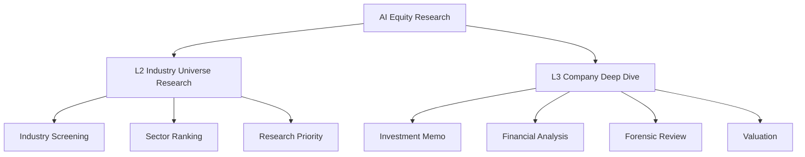

# AI Agent for Equity Research

> **Institutional-style equity research system for Indian listed companies**

<p align="center">


</p>

**Authors:** Ian Dmello & OpenAI

A structured AI-powered equity research framework that generates institutional-quality research reports for Indian industries and companies using official company disclosures, NSE/BSE filings, and a standardized research methodology. The project combines forensic accounting, financial analysis, governance assessment, and valuation into a repeatable research workflow.

---

# Overview

This project aims to build a **private institutional-style research repository** rather than a simple stock screener.

Every report follows a documented framework that emphasizes:

- Official-source verification
- Financial quality assessment
- Governance review
- Forensic accounting checks
- Valuation analysis
- Investment decision framework

The methodology is designed to produce consistent research across multiple industries while maintaining traceability for every factual statement.

---

# Key Features

- Institutional-style research reports
- Industry Universe Screening (L2)
- Company Deep-Dive Reports (L3)
- Financial quality scoring out of 10
- Forensic accounting review
- Corporate governance assessment
- Valuation comparison against peers
- Official NSE/BSE source framework
- Standardized report templates

---

# Research Framework

The project follows a two-level research hierarchy.



This structure is defined by the project's:

- **L2 Industry Universe Template**
- **L3 Company Deep Dive Template**

---

# Report Types

## L2 — Industry Universe Research

### Purpose

- Screen an entire industry
- Rank companies
- Identify research priorities

### Typical Sections

- Industry definition
- Company universe
- Market structure
- Financial screening
- Quality ranking
- Valuation snapshot
- Research priority

### Example Report

**Indian Specialty Chemicals Sector**

The completed L2 report ranked companies such as **SRF**, **Navin Fluorine**, and **PI Industries** as Tier-1 research candidates while applying standardized quality and valuation filters.

### Example Dashboard

| Metric | View |
|---------|------|
| Industry | Specialty Chemicals |
| Market Cap Focus | Large & Mid Cap |
| Long-Term Outlook | Positive |
| Sector Risk | Moderate |

This report serves as the reference format for future industry research.

---

## L3 — Company Deep Dive

### Purpose

Build a complete institutional-style investment case for a single company.

### Mandatory Coverage

- Investment memo
- Business model
- Management review
- Financial analysis
- Forensic accounting review
- Valuation
- Risk register
- Investment scorecard

### Example Report

**Navin Fluorine International Ltd.**

The report includes:

- CDMO-led investment thesis
- Revenue segmentation
- Manufacturing footprint
- Financial performance review
- Forensic accounting assessment
- Premium valuation analysis
- Long-term investment verdict

The completed report concludes with a **Composite Score of 8.9/10** while recommending staggered accumulation due to premium valuation.

---

# Research Methodology

Every report follows a standardized operating manual to ensure consistency and traceability.

## Official Sources

Priority is always given to official company disclosures.

- NSE India
- BSE India
- Annual Reports
- Investor Presentations
- Quarterly Results
- Corporate Governance Reports
- Shareholding Pattern disclosures

Every factual statement is expected to remain traceable to an official source.

---

# Quality Framework

Every company receives a structured assessment across six core pillars.

| Pillar | Purpose |
|---------|---------|
| Growth | Revenue and earnings expansion |
| Profitability | Margins and earnings quality |
| Capital Efficiency | ROCE, ROE and ROIC |
| Balance Sheet | Debt and liquidity |
| Governance | Promoter quality and disclosures |
| Valuation | Relative attractiveness |

Each company ultimately receives a documented score out of **10**.

---

# Financial Analysis

The framework reviews:

- Revenue CAGR
- EBITDA margins
- PAT growth
- EPS
- ROCE
- ROE
- ROIC
- Free Cash Flow
- Debt-to-Equity
- Interest Coverage

Recurring earnings are separated from exceptional items wherever possible.

---

# Forensic Accounting Review

One of the project's distinguishing features is its forensic accounting layer.

### Review Areas

- Receivables quality
- Inventory trends
- Related-party transactions
- Auditor observations
- Exceptional items
- Contingent liabilities

This reflects an internal-audit-oriented research approach rather than a purely valuation-driven process.

---

# Valuation Framework

Each company is evaluated using multiple valuation lenses.

| Metric | Purpose |
|---------|---------|
| P/E | Earnings valuation |
| P/B | Book valuation |
| PEG | Growth-adjusted valuation |
| EV/EBITDA | Capital-structure neutral comparison |
| Dividend Yield | Income perspective |

Valuation is always interpreted alongside business quality and historical trading ranges.

---

# Investment Decision Framework

Rather than issuing simplistic Buy/Sell calls, the framework combines multiple dimensions of quality.

### Assessment Factors

- Business quality
- Financial quality
- Governance
- Competitive moat
- Valuation
- Industry outlook

### Possible Recommendations

| Recommendation | Meaning |
|---------------|---------|
| Buy | Attractive long-term opportunity |
| Buy on Corrections | Strong company at better prices |
| Hold | Quality business but fairly valued |
| Watchlist | Monitor developments |
| Speculative Buy | Higher-risk opportunity |

Examples of this framework are demonstrated in both the **Specialty Chemicals Industry Report** and the **Navin Fluorine Deep Dive**.

---

# Project Structure

```text
AI-Agent-for-Equity-Research/
│
├── README.md
├── PROJECT_RULES.md
│
├── templates/
│   ├── L2_Industry_Universe_Template.txt
│   └── L3_Company_Deep_Dive_Template.txt
│
├── reports/
│   ├── industries/
│   │   └── 2026-08-23_Specialty_Chemicals/
│   │
│   └── companies/
│       └── 2026-08-23_Navin_Fluorine/
│
└── assets/
    └── sample-images/
```

---

# File Naming Convention

Reports follow a consistent version-controlled naming format.

```text
YYYY-MM-DD_ReportName
```

Examples:

- `2026-08-23_Specialty_Chemicals`
- `2026-08-23_Navin_Fluorine`

---

# Review Cycle

| Frequency | Activity |
|------------|----------|
| Daily | Exchange announcements |
| Quarterly | Results, guidance and shareholding |
| Annual | Annual reports, governance review and capital allocation review |

This ensures the repository remains aligned with official company disclosures.

---

# Future Roadmap

Planned enhancements include:

- Automated NSE/BSE data ingestion
- Price trend charts
- Interactive dashboards
- Portfolio tracking
- Earnings preview reports
- Watchlist automation
- AI-generated management Q&A
- Institutional ownership tracking
- Multi-sector research coverage

---

# Disclaimer

This repository is intended for **research and educational purposes only**.

It is **not investment advice**. Investment decisions should be based on individual financial circumstances and independent verification of official company disclosures.

---

# Authors

## Ian Dmello

- Chartered Accountant
- Internal Audit & Forensic Analytics Professional
- AI-driven Equity Research

## OpenAI

- AI Research Assistant
- Financial Analysis Support
- Structured Research Automation

---

<p align="center">
Built with ❤️ for institutional-quality Indian equity research.
</p>


## Sample Research Reports

The following reports demonstrate the output quality and methodology of the AI Equity Research Agent.

| Report | Description |
|--------|-------------|
| 📊 [Indian Specialty Chemicals – L2 Industry Universe Report](2026-08-23_Specialty_Chemicals_L2_Industry_Universe_Report_v2.pdf) | Institutional-style industry screening covering market structure, company universe, financial screening, quality rankings, valuation snapshot, and research prioritization. |
| 📈 [Navin Fluorine International – L3 Company Deep Dive Report](2026-08-23_Navin_Fluorine_L3_Deep_Dive_Report_Professional.pdf) | Comprehensive company analysis including investment thesis, financial performance, forensic accounting review, valuation framework, risk register, and investment scorecard. |

> **Note:** The underlying research templates, scoring models, and operating framework are proprietary and are not included in this public repository.
